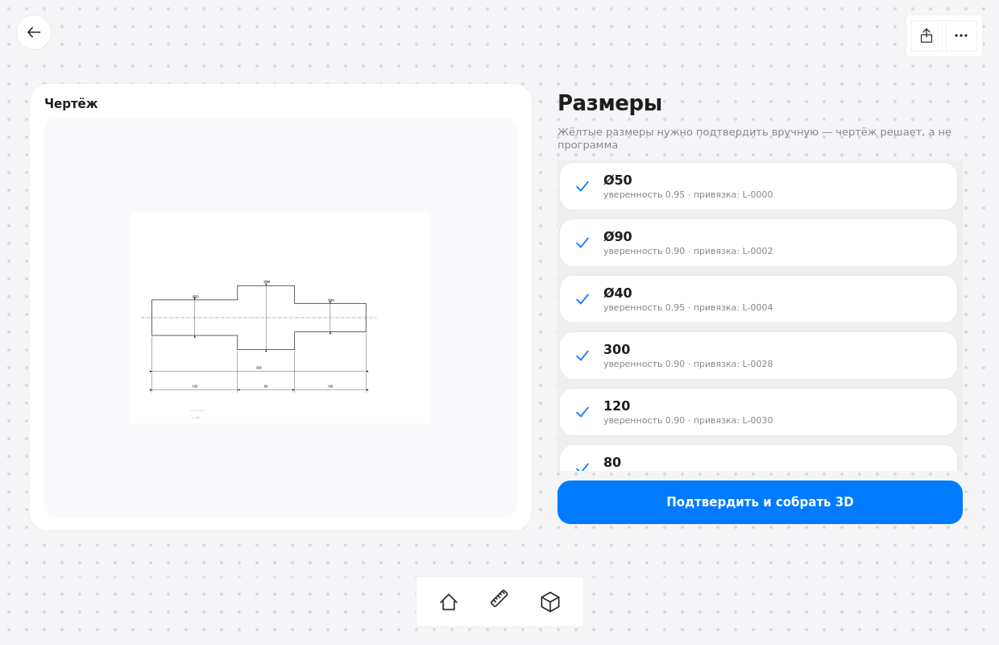
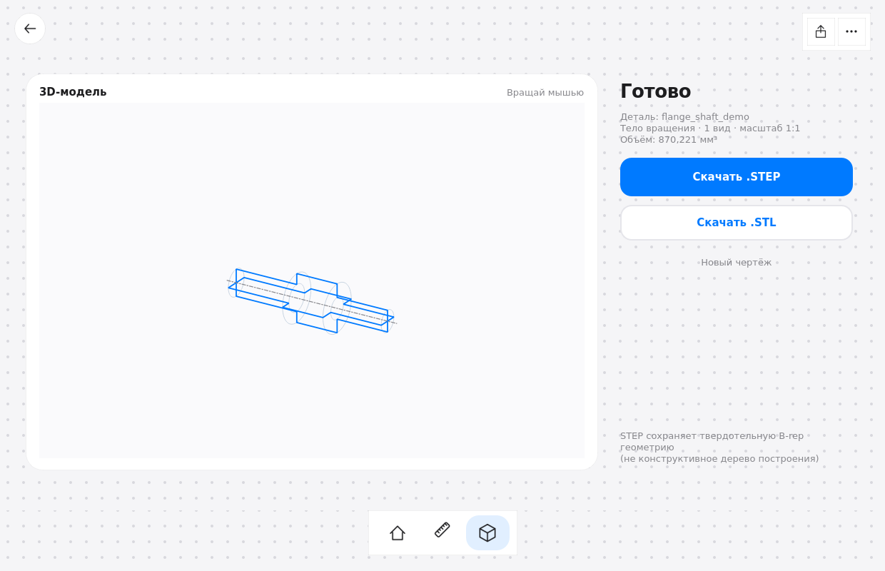
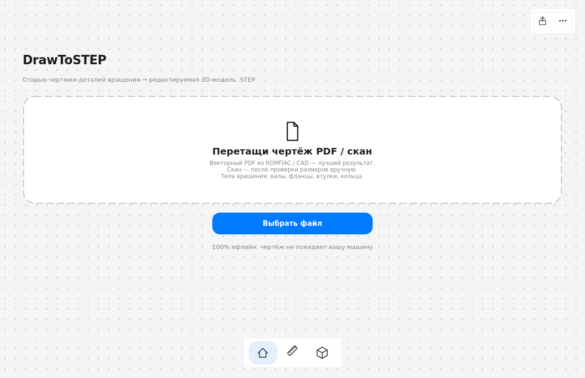

# DrawToSTEP

[](https://github.com/Igorr112323/Scanning-of-drawings/actions/workflows/ci.yml)

**Офлайн-конвертер старых чертежей деталей вращения в редактируемые твердотельные 3D-модели STEP.**
**Offline converter from legacy GOST/ESKD drawings of bodies of revolution to editable solid 3D STEP models.**

---

## Зачем это нужно / Why

Фонд оборудования десятилетиями хранит чертежи на бумаге и в векторных PDF (КОМПАС, AutoCAD).
Восстановление 3D-модели вручную занимает ~25 минут на деталь. DrawToSTEP делает черновую геометрию
за секунды, а человек только **подтверждает распознанные размеры** — и ни один размер не применяется
без явного подтверждения пользователя.

Existing STEP exporters give you geometry but no engineering intent; CAD import of drawings gives you lines,
not solids. DrawToSTEP closes that gap for a narrow, well-defined class of parts: **тела вращения**.

## Почему 100% офлайн / Why fully offline

- Чертежи часто содержат К-сведения: оборонка, медицина, приборостроение, режимные предприятия.
- Облачный OCR/CAD-сервис = юридически невозможный сценарий.
- Никаких сетевых вызовов в коде: PDF разбирается локально (PyMuPDF), OCR — локальный RapidOCR (ONNX) с опциональным fallback на Tesseract, CAD — локальный OpenCASCADE.
- Целевая упаковка: локальный `.exe` через PyInstaller (Phase 2).

## Что уже работает (MVP, Phase 1) / What works now

| Возможность | Статус |
|---|---|
| Тела вращения: валы, фланцы, втулки, кольца (1 главный вид) | ✅ |
| Векторный PDF (КОМПАС / AutoCAD, mm/pt, любой масштаб) | ✅ |
| Парсинг линий, осей, текстов размеров (без OCR) | ✅ |
| GOST 2.302 inference масштаба чертежа (1:2 … 50:1) | ✅ |
| Проверка противоречий размер ↔ геометрия | ✅ |
| Распознавание Ø, R, M, линейных размеров | ✅ |
| **Human-in-the-loop: неуверенные размеры подсвечены жёлтым, 3D не собирается без подтверждения** | ✅ |
| Сборка тела вращения (CadQuery / OpenCASCADE) | ✅ |
| Экспорт **STEP** (B-rep, открывается в FreeCAD / КОМПАС / SolidWorks) и **STL** | ✅ |
| UI в стиле iOS (PySide6): Upload → Processing → Verification → 3D Viewer | ✅ |
| pytest + GitHub Actions | ✅ |
| Сканы: OpenCV-конвейер (deskew/binarize/векторизация) + локальный RapidOCR, привязка размеров к линиям чертежа | ✅ 10/10 привязано на тестовом скане; неуверенные — кликом по линии |
| OCR произвольного шрифта (Tesseract) | ⏳ v1.1/Phase 2 |
| Клик-привязка размера к линии контура («Указать на чертеже») | ✅ неуверенные строки в Verification |

## Что не входит в MVP / Out of scope (Phase 2, см. Issues)

- Призматические детали (плиты, кронштейны) — issue
- Растровые сканы: промышленный OCR-конвейер — issue
- Датасет 100+ чертежей фланцев/валов — issue
- Нейросетевая сегментация (YOLO/UNet) — issue
- Упаковка в .exe (PyInstaller) — issue
- Сечения А-А, скрытые линии, фаски/галтели в 3D, резьбы, перенос шероховатости и допусков в PMI

## Скриншоты / Screens

<p align="center">
  
  
</p>
<p align="center">
  
</p>

## Демо для защиты / Demo for defense (UMNIK)

**Скачать `DrawToSTEP.exe`:** вкладка [Releases](../../releases) → последний релиз
(артефакт собирается автоматически при публикации релиза, Windows x64, Python не нужен).
Сборка из исходников: `pyinstaller --noconfirm DrawToSTEP.spec` (см. `.github/workflows/build-exe.yml`).

30-секундный сценарий (полный скрипт с репликами — [docs/DEMO_SCRIPT.md](docs/DEMO_SCRIPT.md)):

1. Запусти `DrawToSTEP.exe` (или `python -m app.main --demo`) — в окно **уже загружен пример** вала Ø50–Ø90–Ø40 (`--demo` пропускает выбор файла).
2. Экран «Размеры»: 7 размеров, все уверенные (зелёные), масштаб определён автоматически (ГОСТ 2.302).
3. «Подтвердить и собрать 3D» → вращай мышью → «Скачать .STEP» / «Скачать .STL».

Скан-ветка: перетащи `data/examples/real/scan_test.png` (регенерируется
`python data/examples/real/generate_real_examples.py`) — диаметры (RapidOCR теряет Ø)
показываются как «Ø60 — предложено по геометрии — подтверди»: 1 клик «Подтвердить» ×4,
и 3D собрана (погрешность объёма **+0.26 %**).



## Быстрый старт / Quick start

```bash
python3.11 -m venv .venv
source .venv/bin/activate          # Windows: .venv\Scripts\activate
pip install -r requirements.txt

# Linux: OpenCV нужен системный libGL (CI это делает автоматически)
# Debian/Ubuntu: sudo apt-get install -y libgl1 libglu1-mesa libegl1
# Windows/macOS: отдельно ставить нечего

# GUI (нужен дисплей; Linux: системные libGL/xkbcommon)
python -m app.main            # GUI
python -m app.main --demo     # GUI с предзагруженным примером (для жюри)
python -m app.main --selftest # дымовой тест без окна (CI)
```

Готовый пример чертежа уже в репозитории: **`data/examples/flange_shaft_demo.pdf`**
(синтетический вал Ø50–Ø90–Ø40, масштаб 1:1, А3). Сгенерировать заново:

```bash
python -m data.examples.generate_example
```

### Проверка среза без GUI / Headless vertical slice

```bash
python -m app.main --headless data/examples/flange_shaft_demo.pdf --out exports
```

Ожидаемый вывод:

```
Распознано размеров: 7 (уверенных: 7, требуют проверки: 0)
  Ø50  conf=0.95 ok   Ø90  conf=0.90 ok   Ø40  conf=0.95 ok
  300  conf=0.90 ok   120  conf=0.90 ok   80  conf=0.90 ok   100  conf=0.90 ok
STEP: exports/flange_shaft_demo.step
STL:  exports/flange_shaft_demo.stl
```

STEP-файл открывается в FreeCAD и в КОМПАС-3D (Файл → Открыть).

### В GUI

1. Перетащи `flange_shaft_demo.pdf` в окно → Processing → **Verification**.
2. Все 7 размеров распознаны уверенно (зелёные). Чтобы увидеть жёлтую строку,
   отредактируй любой размер на заведомо неверный — кнопка «Подтвердить и собрать 3D»
   будет неактивна, пока не подтвердишь.
3. Нажми «Подтвердить и собрать 3D» → вращай модель мышью → «Скачать .STEP» / «Скачать .STL».

## Тесты / Tests

```bash
pytest                      # 116 passed + 1 skipped (Qt-GUI): парсер, солвер, CAD, OCR-правила, привязка размеров на сканах, Ø-recovery, бенчмарк сканов, корпусные фикстуры
```

CI: `.github/workflows/ci.yml` — pytest на каждый push/PR + headless-прогон примера.
Ночной корпусный прогон: `.github/workflows/corpus-nightly.yml` (Zenodo, --limit 200, артефакты).

## Архитектура / Architecture

См. [docs/ARCHITECTURE.md](docs/ARCHITECTURE.md) и [docs/ROADMAP.md](docs/ROADMAP.md).
Ключевые файлы: `core/pdf_parser.py`, `core/ocr_gost.py`, `core/constraint_solver.py`,
`core/cad_builder.py`, `core/scan_pipeline.py`, `core/scan_linking.py`, `app/ui/`.

## Принципы / Engineering rules

1. **Приложение не выдумывает размеры.** Если уверенность < 0.85 или размер не привязан
   к геометрии → `is_uncertain=True`, жёлтая подсветка, и 3D-сборка заблокирована до подтверждения.
2. **Ничего не отправляется наружу.** Нет телеметрии, нет облака, нет сетевых вызовов.
3. **STEP — это твердотельное B-rep, а не параметрическое дерево.** Фаски/скругления/резьбы
   будут фичами модели (Phase 2), а не молчаливыми аппроксимациями меша.
4. **Solver не «чинит» чертёж молча** — противоречия выводятся пользователю как ошибки.


## Метрики (честные, по демо-примеру) / Success metrics

| Метрика | Цель | Замер на `flange_shaft_demo.pdf` |
|---|---|---|
| Время генерации | ≪ ручного перерисовывания (~25 мин) | **~29 мс** парсинг+сборка (+ время подтверждения человеком) |
| Точность размеров после солвера | 0.01 мм | объём модели совпадает с расчётным телом вращения (< 1e-3 отн. погр.) |
| Галлюцинации размеров | 0 | 0 — любой неуверенный размер блокирует 3D |

## Корпус реальных чертежей / Real-corpus benchmark

Проверка на реальных открытых корпусах (Zenodo CC-BY, HF) — скачивание, скрининг
(осевые линии/симметрия/Ø), прогон всего конвейера, отчёт о распределениях и ошибках.
Детали: [docs/DATA_SOURCES.md](docs/DATA_SOURCES.md), [README_RU.md](README_RU.md),
[docs/CORPUS_BENCHMARK.md](docs/CORPUS_BENCHMARK.md), [docs/BUG_HARVEST.md](docs/BUG_HARVEST.md).

**Атрибуция (CC BY 4.0):** Open Mechanical 3D Models Dataset (zenodo.org/records/24167336),
licensed under CC BY 4.0 — https://creativecommons.org/licenses/by/4.0/

Unlicensed HF corpora (jcrzd, ecado) are used for aggregate internal evaluation metrics only —
never committed, never in releases, never cited as a redistributable dataset
(see `docs/DATA_SOURCES.md` → Legal table).

**Статус честный:** корпус ещё не загружен (хосты недоступны из build-песочницы;
первый прогон — ночной CI). Метрики корпуса: **NOT MEASURED** — будут взяты из
закоммиченного `data/corpus/results.jsonl`, без выдуманных чисел.

## Ограничения / Honest limitations

- Только один главный вид и только тела вращения. Эксцентрики, шпоночные пазы, отверстия на торцах — Phase 2.
- Штриховка, скрытые линии, сечения А-А игнорируются парсером v1.
- Масштаб чертежа определяется только из стандартного ряда ГОСТ 2.302; нестандартное масштабирование
  («как влезло») будет определено, но отмечено предупреждением.
- Сечения/фаски: v1 выдаёт ступенчатое тело вращения; конические фаски из чертежа не восстанавливаются.
- STEP — B-rep solid, не Feature Tree. Редактирование истории построения — задача CAD-пакета пользователя.
- Сканы: OpenCV-конвейер (deskew/binarize/векторизация) + локальный RapidOCR работают; на синтетическом скане shaft-примера восстановлено тело с точностью **+0.26 % по объёму** (обе фаски 2×45° и отверстие Ø12.19 учтены). Привязка размеров: **10/10 авто-привязано**, но 4 диаметра (RapidOCR теряет символ Ø и пишет ведущий ноль: `060`, `012`…) приходят с уверенностью 0.80 и **всегда подтверждаются в UI кликом «Указать на чертеже»** по размерной линии — неуверенные размеры никогда не применяются молча. Качество OCR на шумных сканах не промышленное — Phase 2.
- Проверка линейных размеров по скану использует толеранс по пикселизации (`max(0.05, 24 px)` ≈ 3 мм при 200 DPI) — растр «съедает» концы штрихов (~10 px на сторону); PDF-чертежи по-прежнему проверяются с 0.05 мм.

## Структура репозитория / Repository layout

```
app/        PySide6 UI (iOS-стиль): main.py — точка входа
core/       парсер PDF, OpenCV-препроцессинг, векторизация, OCR-правила,
            солвер ограничений, CAD-сборка (CadQuery), модели данных
tests/      pytest
data/examples/   синтетический пример + генератор (код, не скачано извне)
docs/       ARCHITECTURE.md, ROADMAP.md, BENCHMARK.md
```

## Лицензия / License

Внутренний проект (proprietary), см. pyproject.toml. Зависимости — под их собственными лицензиями
(CadQuery — Apache-2.0, PyMuPDF — AGPL/commercial, OpenCASCADE — LGPL-2.1).

---

*English summary:* DrawToSTEP parses a vector GOST/ESKD drawing of an axisymmetric part (shaft/flange/bushing/ring),
recognizes dimensions (Ø/R/M/linear), cross-checks them against the reconstructed profile with GOST scale inference,
requires explicit human confirmation of anything uncertain, revolves the confirmed profile with CadQuery/OpenCASCADE,
and exports STEP/STL. Scans (PNG/JPG/TIFF/BMP) run the same pipeline — OpenCV deskew/binarization, vectorization and
local RapidOCR — with dimensions that OCR cannot read confirmed by clicking «Указать на чертеже» (click-to-link).
Fully offline; no dimension is ever invented; unconfirmed dimensions block export.
